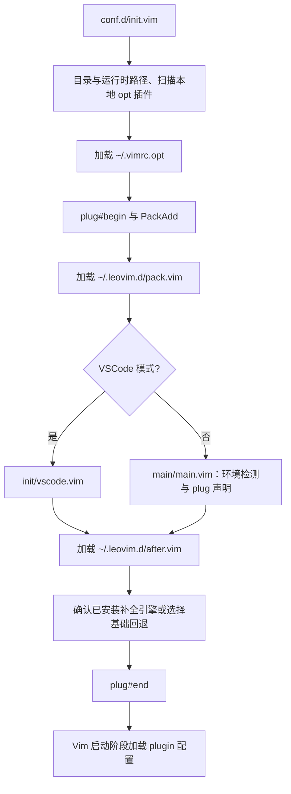

# LeoVim

面向开发的 Vim / Neovim 配置。以 Vimscript 为入口，按编辑器版本、外部工具和用户开关选择补全、搜索、语言工具与调试方案；VSCode Neovim 使用独立配置分支。

本文描述仓库提供的能力和启用条件，不表示所有插件都默认安装。快捷键可能受模式、文件类型、插件是否安装及用户配置影响，最终以 `:verbose nmap` / `:verbose imap` / `:verbose xmap` 的结果为准。

## 1. 功能概览

| 功能 | 实现与配置入口 |
|---|---|
| 补全、片段与语言服务 | builtin / mucomplete / Coc / nvim-cmp / blink.cmp；[`application.vim`](conf.d/plug/application.vim)、[`complete.vim`](conf.d/main/plugin/complete.vim)、[`lsp.lua`](conf.d/main/lua/lsp.lua) |
| 文件、内容与符号搜索 | FZF、LeaderF；未安装两者时 Neovim 使用 Snacks、Vim9 使用 Fuzzbox 托底；LSP、Ctags/Gtags 与 Grep；[`search.vim`](conf.d/main/plugin/search.vim)、[`tags.vim`](conf.d/main/plugin/tags.vim) |
| 语法树与文本对象 | 符合版本条件时使用 Treesitter，另有 Vim 文本对象插件；[`treesitter.lua`](conf.d/main/lua/treesitter.lua)、[`textobj.vim`](conf.d/init/plugin/textobj.vim) |
| 文件树、符号侧栏与状态栏 | 根据已选插件启用；[`sidebar.vim`](conf.d/main/plugin/sidebar.vim)、[`lightline.vim`](conf.d/main/plugin/lightline.vim) |
| 主题、窗口与标签页 | [`scheme.vim`](conf.d/main/plugin/scheme.vim)、[`window.vim`](conf.d/main/plugin/window.vim)、[`tab.vim`](conf.d/main/plugin/tab.vim) |
| Git | Fugitive、GV、LeaderF Git、可选 LazyGit；[`git.vim`](conf.d/main/plugin/git.vim) |
| 异步任务与文件运行 | AsyncRun / AsyncTasks；[`run.vim`](conf.d/main/plugin/run.vim)、[`任务模板`](conf.d/tasks/) |
| 调试 | Vimspector、nvim-dap 或 Vim termdebug；[`debug.vim`](conf.d/main/plugin/debug.vim) |
| 终端、REPL 与 AI CLI | Floaterm 及本地增强插件；[`terminal.vim`](conf.d/main/plugin/terminal.vim)、[`repl.vim`](conf.d/main/plugin/repl.vim)、[`vim-floaterm-enhance`](conf.d/pack/leo/opt/vim-floaterm-enhance/) |
| 会话与文件历史 | Startify、FZF 会话选择与历史工具；[`session.vim`](conf.d/main/plugin/session.vim)、[`history.vim`](conf.d/main/plugin/history.vim) |
| 项目文件模板 | 新建 `.gitignore`、`.gitconfig`、`.lintr`、`.Rprofile`、`.wildignore`、`.radian_profile` 时插入对应模板；[`set.vim`](conf.d/init/plugin/set.vim)、[`templates`](conf.d/templates/) |

新建文件时插入模板不等于自动为所有项目创建这些文件。离线运行也需要事先准备所选插件、语言服务器及外部工具。

Fuzzbox 通过 `pack/clone/opt/update-clone.sh` 克隆到本地 opt，再由 `init.vim` 在 `plug#end()` 前通过 `PackAdd 'fuzzbox.vim'` 注册。条件是未安装 LeaderF/FZF、非 Neovim，且有 vim9script/popupwin；不是只检查是否声明。默认插件快捷键关闭，后备沿用 `<Leader>ff`（当前文件目录）、`<Leader>p`（VCS 目录）、`<C-p>`（项目根）、`<Leader>b`、`<Leader>u`、`<M-l><M-l>`、`<Leader>T` 和 `t<CR>`；当前文件标签需要 ctags，读取已保存文件。

Fuzzbox 使用顶部输入、结果自上而下的布局；`Ctrl-j` 向下、`Ctrl-k` 向上，同时保留 `Ctrl-n/p` 和方向键。当前文件标签列表的 `Ctrl-]` 仍为垂直分屏打开。

Snacks 同样克隆在 `pack/clone/opt/snacks.nvim`，由 `update-clone.sh` 维护，使用 `PackAdd 'snacks.nvim'` 注册，不交给 vim-plug 下载。Neovim 0.9.4+ 在启动时执行 [`cfg/snacks.lua`](conf.d/main/lua/cfg/snacks.lua)，启用 input / picker，接管 `vim.ui.input` 和 `vim.ui.select`，替代 dressing.nvim；这部分不受 FZF / LeaderF 是否安装影响。Dropbar 不再覆盖 `vim.ui.select`。

仅在 FZF、LeaderF 都未安装时，通用文件、缓冲区、历史、搜索与标签快捷键才回退到 Snacks；已有 FZF / LeaderF 的优先级保留。无论是否安装它们，都可以通过 `:SnacksPicker` 打开 Snacks 的全部 picker 入口（例如诊断、LSP、撤销历史等，各自仍需相应数据或服务）。Snacks 选择器使用 `Ctrl-j/k` 上下移动，`Ctrl-]` 垂直分屏打开。文件枚举无需 fzf，内容搜索需要 rg；标签 picker 读取已有的 tags，沿用本配置的 ctags / gutentags 流程，当前文件标签仅保留该文件条目，Coc / Vista 的原有专用入口仍优先。

`<M-l><M-a>` 搜索已加载且列出的普通缓冲区，包含未保存修改，不用磁盘上的 rg 结果冒充缓冲区内容。Snacks 跳转期间会临时清空 `switchbuf`，防止 `useopen` 复用即将关闭的预览浮窗；动作结束（包括报错）后恢复原值。项目 / VCS 路径使用原始 Lua 路径，支持目录名中的空格，不把 Ex 命令转义后的字符串交给 finder。

这里只自动启用 input / picker，不默认打开 dashboard、notifier、scroll 或终端等其他模块，避免覆盖现有启动页、通知和 Floaterm 配置。

## 2. 系统要求与补全选型

### 2.1. 入口与工具要求

| 用途 | 当前配置条件 |
|---|---|
| 配置入口 | Vim 7.4.399+ 或 Neovim 0.8+；Windows 上的 Vim 另要求 9.0+ |
| VSCode Neovim 分支 | Neovim 0.10+，并安装 VSCode 的 `vscode-neovim` 扩展 |
| 安装与更新 | Git；Unix 安装脚本使用 Bash，下载步骤还会调用 curl / wget、tar 等工具 |
| Coc | `coc` 开关、检测到 Node.js 24+，且 `has('patch-9.0.0438')` 成立；master 分支安装钩子运行 `npm ci` |
| Neovim 原生 LSP | Neovim 0.11+，并选择 `cmp`、`blink` 或 `blink.lua` |
| Treesitter | Neovim 0.9.2+ 且低于 0.12，`g:nvim_treesitter_install` 为真；模板默认在 Unix 启用此开关 |
| Vimspector | 编辑器内可用的 Python 3.10+；Vim 8.2.4797+ 或 Neovim 0.8+，具体选择见第 7.7 节 |

最低入口版本只保证通过入口检查，不保证所有可选插件能在该版本运行。语言服务器、调试器、AI CLI、解释器及编译器有各自的运行要求。Ctags/Gtags、ripgrep、FZF、Python provider 等按所选功能准备，不是互相的替代品。

### 2.2. 补全引擎

在 `~/.vimrc.opt` 中选择所需方案。高级引擎声明顺序为 **cmp → blink → Coc**，不要同时启用多个方案来依赖这个优先级。

| 方案 | 配置方式 | 说明 |
|---|---|---|
| nvim-cmp | `call pack#add('cmp')` | Neovim 0.11+，配合原生 LSP |
| blink.cmp | `call pack#add('blink')` | Neovim 0.11+；有 cargo 时声明构建钩子 |
| blink Lua 方案 | `call pack#add('blink.lua')` | 不走配置中的 cargo 构建分支 |
| Coc | `call pack#add('coc')` | 满足上表 Node.js 和编辑器检测条件后声明插件；通过 Coc 扩展提供语言功能 |
| builtin | 不选择高级引擎，也不强制 `mcm` | Neovim 0.11+ 或 Vim 9.1.1590+ 自动选择原生补全；不等于自动启用完整 LSP 配置 |
| mucomplete | `call pack#add('mcm')`，或旧编辑器自动回退 | 路径、omni、关键字、字典等补全；不需要 Node.js |
| 关闭基础补全回退 | `call pack#add('nocomplete')` | 同时不要选择高级补全引擎 |

高级插件已声明但尚未安装时，当前会话会回退到 builtin / mucomplete。安装后重启编辑器再检查 `g:complete_engine`。代码片段主要由 vim-vsnip、friendly-snippets 和 [`conf.d/snippets/`](conf.d/snippets/) 提供，实际按键随补全方案变化。

仓库的 [`opt.vim`](conf.d/init/opt.vim) 是开关示例：语言、调试、Coc、cmp、blink 等 `pack#add` 行多数默认注释，不应把示例当作已启用配置。

## 3. 安装、更新与卸载

### 3.1. Linux / macOS

先备份现有 Vim、Neovim 和 Zed 配置，再执行：

```bash
git clone https://gitee.com/leoatchina/leovim ~/.leovim
cd ~/.leovim
./install.sh
```

**无参数运行也会联网并安装/更新插件**：脚本建立入口配置和启动脚本，克隆或更新 `~/.leovim.unix`，在缺失时复制 `~/.vimrc.opt`，默认调用启动包装脚本运行 `PackUpdate`。

主要文件行为：

- 缺失时创建 `~/.vimrc`、`~/.config/nvim/init.vim`，不直接覆盖已有入口文件。已有入口需自行接入 `source ~/.leovim/conf.d/init.vim`。
- 复制启动脚本到 `~/.local/bin`；复制部分 shell 配置时使用不覆盖方式。
- 强制链接 Zed 的 `~/.config/zed/keymap.json`，已有该文件时应先备份。
- 从其他位置安装时，若 `~/.leovim` 已存在且不是目标链接，会先改名备份。

| 命令 | 额外行为 |
|---|---|
| `./install.sh normal no` | 跳过最后的插件更新步骤，仍会执行基础配置和 `leovim.unix` 联网步骤 |
| `./install.sh basic` | 增加 Neovim、nvm / Node.js 安装步骤 |
| `./install.sh all` | 在 basic 基础上增加 Rust、gvm 安装步骤，可能运行外部安装脚本 |
| `./install.sh neovim` | 当前下载脚本指定的 Neovim **v0.11.7**，不是自动选择最新版本 |
| `./install.sh nvm` | 安装/更新 nvm，安装 Node.js 24 并设为默认版本 |
| `./install.sh rc` | 单独处理 Bash/Zsh 配置，可能询问是否备份已有配置 |
| `./install.sh leotmux` | 安装/更新 leotmux、TPM、tmux-fzf，可能链接 `~/.tmux.conf` |

安装步骤依赖网络、平台、可执行文件及权限，不承诺 `all` 能在任意环境一次成功。执行前可先阅读 [`install.sh`](install.sh)。

### 3.2. Windows

在 Git for Windows 可用的环境中，以具备创建符号链接权限的命令提示符执行：

```cmd
git clone https://gitee.com/leoatchina/leovim %USERPROFILE%\.leovim
cd /d %USERPROFILE%\.leovim
install.cmd
```

[`install.cmd`](install.cmd) 创建缺失的入口配置，处理 Zed 键位链接，并克隆/更新 `~/.leovim.windows`。它与 Unix 安装器并非相同流程：没有 Unix 安装器末尾的插件更新步骤，需进入编辑器执行 `:PlugInstall`。已有 Zed 键位文件会被删除再建立链接，应先备份。

### 3.3. 更新与离线迁移

```bash
cd ~/.leovim
git pull
```

先保留本地修改，不要通过重置仓库强行更新。在编辑器中按需要执行：

```vim
:PlugStatus
:PlugInstall
:PlugUpdate
:CocUpdate
```

`CocUpdate` 只适用于 Coc。`PackUpdate` 是 LeoVim 包装命令，会重新读取 `~/.vimrc.opt` 后调用 `PlugUpdate`；开关或插件声明变化后，重启再更新更容易确认实际选择。

[`scripts/compress.sh`](scripts/compress.sh) 输出 `~/leovim.tar.gz`，打包指定的 `.local` 工具、`.leovim`、`.leovim.d` 和 `.leovim.unix`，并排除 `.git`。它不是完整的个人配置备份：`~/.vimrc.opt` 和编辑器入口文件需单独备份，用户钩子随 `.leovim.d` 打包；缺失的工具路径也可能令 tar 报错。不同平台的二进制、Python 环境和动态库不能仅靠复制保证可用，解压后直接运行安装器仍可能联网。

### 3.4. 卸载风险

仓库提供 [`uninstall.sh`](uninstall.sh) 和 [`uninstall.cmd`](uninstall.cmd)，执行前必须阅读脚本并备份。

**Unix 卸载脚本会删除入口文件、`~/.vimrc.opt`，并递归删除匹配 `~/.leovim*` 的路径，包括用户数据、工具目录及同前缀备份。** 它不只是移除软链接，不建议在未确认这些路径内容时执行。

## 4. 配置结构与加载顺序

### 4.1. 目录职责

```text
~/.leovim/
├── conf.d/
│   ├── init.vim              # 唯一受支持入口
│   ├── init/
│   │   ├── opt.vim           # 用户开关模板
│   │   ├── vscode.vim        # VSCode Neovim 分支
│   │   ├── keybindings.json  # VSCode 键位参考
│   │   ├── autoload/         # utils、pack 等工具
│   │   ├── plugin/           # 基础设置、文件类型检测、文本对象
│   │   ├── ftplugin/         # 随仓库维护的文件类型配置
│   │   └── lua/              # Neovim 工具模块
│   ├── plug/                 # 插件声明：application/common/languages/symbol/zfvim
│   ├── main/
│   │   ├── main.vim          # 环境检测和插件声明加载
│   │   ├── plugin/           # 各功能模块
│   │   ├── autoload/         # vim-plug 等运行时函数
│   │   ├── lua/              # LSP、Treesitter 与 cfg 插件模块
│   │   └── after/
│   │       ├── cfg/          # 按条件 source 的 Vimscript 配置
│   │       └── lsp/          # 语言服务器 Lua 配置
│   ├── pack/leo/opt/         # 本地插件，包含 Floaterm 增强
│   ├── snippets/             # VSCode 格式片段
│   ├── tasks/                # AsyncTasks 全局任务和示例
│   ├── templates/            # 新文件模板
│   ├── dap/                  # nvim-dap 单个配置对象模板
│   └── vimspector/           # Vimspector 完整项目模板
├── pack/                     # 随仓库提供的插件、主题和基础运行时
├── scripts/                  # 启动、打包和 shell 工具
├── docs/                     # 补充记录
├── fonts/                    # 字体
├── assets/                   # 图片等资源
├── install.sh / install.cmd
└── uninstall.sh / uninstall.cmd
```

### 4.2. 启动流程



`after/cfg/*.vim` 不会全部自动执行；功能模块按条件 `source` 它们。Lua 文件也由对应的 `require` 加载，不是因为放在 `lua/` 下就全部自动执行。

EasyAlign、GV、vim-header、vim-translator、Neoformat 按需加载；nvim-bqf 按 `qf`、render-markdown 按 `markdown`/`vimwiki` 加载。原快捷键不变。

### 4.3. 用户修改放在哪里

| 文件 | 用途 |
|---|---|
| `~/.vimrc.opt` | 功能开关、工具路径、插件配置变量，尽早设置 |
| `~/.leovim.d/pack.vim` | 通过 `PackAdd` 声明额外插件 |
| `~/.leovim.d/after.vim` | 用户配置钩子；它在后续 `plugin/*.vim` 自动加载之前执行，不能保证直接写的映射一定最后生效 |

文件类型定制可在 `after.vim` 中使用带分组的 `FileType` 自动命令。不要假定 `~/.leovim.d/ftplugin/` 自动加入了 runtimepath；仓库未为该目录建立通用自动加载约定。

## 5. VSCode Neovim

安装 VSCode 的 `vscode-neovim` 扩展，准备 Neovim 0.10+。将入口配置指向 `conf.d/init.vim`，例如 `settings.json`：

```json
{
  "vscode-neovim.neovimInitVimPaths.linux": "/home/you/.leovim/conf.d/init.vim",
  "vscode-neovim.neovimInitVimPaths.darwin": "/Users/you/.leovim/conf.d/init.vim",
  "vscode-neovim.neovimInitVimPaths.win32": "C:\\Users\\you\\.leovim\\conf.d\\init.vim"
}
```

平台键及路径设置以所安装扩展的[设置 schema](https://github.com/vscode-neovim/vscode-neovim/blob/master/package.json) 为准，路径请替换为本机绝对路径。参考 [`conf.d/init/keybindings.json`](conf.d/init/keybindings.json) 合并需要的键位，而不是直接覆盖已有文件。

该模式走 [`init/vscode.vim`](conf.d/init/vscode.vim)，不加载常规 `main/main.vim` 的整套配置。下面的终端、调试和插件键位主要描述普通 Vim / Neovim；例如 VSCode 分支把 `M` 映射为 VSCode 格式化操作，不能直接套用普通模式说明。

## 6. 快捷键约定与核查

| 按键记法 | 实际按法 |
|---|---|
| `<Leader>` | 空格 |
| `<LocalLeader>` | `q` |
| `<M-e>D` | 先按 `Alt+e`，再按大写 `D` |
| `<M-+>` | `Alt++` |

- 除非特别标注，下面描述普通模式。`nmap`、`imap`、`xmap`、`tmap` 分别用于普通、插入、可视和终端输入模式。
- WhichKey 由 `g:leovim_whichkey` 控制；只有配置过提示的前缀才会显示菜单，不是任意按键都能自动显示所有命令。

| 前缀 | 功能域 |
|---|---|
| `<M-h>` | 配置与项目文件 |
| `<M-j>` | 打开光标下文件 |
| `<M-k>` | 功能开关、信息与命令 |
| `<M-l>` | 语言服务及行搜索 |
| `<M-r>` | 任务选择命令，不是多键前缀 |
| `<M-e>` / `<M-m>` | 调试控制 / 调试窗口 |
| `<M-i>` / `<M-a>` | AI CLI / REPL |
| `<M-g>` | Git |
| `s`、`;`、`,`、`[`、`]`、`<Tab>`、`\` | 按模块提供跳转、移动、窗口等组合键 |

| 原生按键 | 当前行为与条件 |
|---|---|
| `H` | 定位到首个非空白字符 |
| `L` | 定位到行末非空白字符 |
| `s` | 作为组合键前缀 |
| `J` | 普通模式在调试配置生效时用于变量求值/诊断 |
| `q` | 仍用于原生宏录制 |
| `M` | 普通配置中可作为 WhichKey 前缀，不是宏录制替代键 |

查看实际映射及定义位置：

```vim
:verbose nmap <F5>
:verbose nmap <C-h>
:verbose imap <Tab>
:verbose xmap Y
:verbose tmap <M-->
:scriptnames
```

## 7. 常用功能

### 7.1. 文件、侧栏、标签页与会话

| 按键 | 功能与条件 |
|---|---|
| `<Leader>ff` | 当前目录文件搜索，按配置使用 LeaderF / FZF 等 |
| `<Leader>p` | 在版本控制目录下搜索文件，不等于 `git ls-files` |
| `<C-p>` | 文件搜索入口，具体后端与目录以当前映射为准，不是固定的树浏览器 |
| `<C-b>` | 文件树侧栏，需已配置对应插件 |
| `<C-t>` | 符号侧栏，取决于 Aerial / Vista / Tagbar 是否可用 |
| `<Leader>Q` | 关闭其他 buffer，不是关闭当前 buffer |
| `;b` / `,b` | buffer 导航 |
| `<M-n>` / `<M-p>` | 下一个 / 上一个标签页 |
| `<M-1>` … `<M-9>` | 按编号切换标签页 |
| `<Leader>st` | Startify 启动页 |
| `<Leader>ss` | FZF 会话选择，需 FZF |
| `<Leader>sv` / `sl` / `sd` | 预填保存 / 加载 / 删除会话命令，需继续输入或确认 |
| `<Leader>sc` | 关闭当前会话 |

会话功能由 [`session.vim`](conf.d/main/plugin/session.vim) 配置。不要把可保存会话等同于退出时必定自动保存所有工作。

Vim 的菜单式 WinBar 保留文件名，仅在 `pack#installed_coc()` 成立时读取 [coc-symbol-line](https://github.com/xiyaowong/coc-symbol-line) 的符号路径；没安装 Coc 时保持文件名显示。扩展已加入 Coc 自动安装列表，也可执行 `:CocInstall coc-symbol-line`。使用 `b:coc_symbol_line_full_plain` 显示完整的当前符号路径，不受 `maxItems` 截断；`symbol-line.onlyNearestKinds` 设为空数组，保留同类型嵌套层级。层级仍取决于语言服务器和启用的符号类型。显示前清除高亮和点击格式码，并转义菜单特殊字符；光标停留时刷新，未提供符号时只显示文件名。这是菜单文本展示，不提供扩展状态栏版本的逐符号点击功能。Neovim 的 Dropbar 分支不变。


### 7.2. 配置文件入口

`g:leovim_openmap` 控制大部分相关打开映射，具体定义见 [`file.vim`](conf.d/main/plugin/file.vim)；`<M-h>o` 在该开关判断之前定义。常用项：

| 按键 | 目标 |
|---|---|
| `<M-h>i` / `<M-h>m` | 入口 `init.vim` / `main.vim` |
| `<M-h>o` / `<M-h>O` | 用户 `.vimrc.opt` / 仓库开关模板 |
| `<M-h>A` / `<M-h>P` | 用户 `after.vim` / `pack.vim` |
| `<M-h>a` | `application.vim` 插件声明 |
| `<M-h>v` / `<M-h>k` | VSCode 配置 / 键位参考 |
| `<M-h>r` / `<M-h>t` | 项目 README / TODO |

### 7.3. 内容搜索与替换

见 [`search.vim`](conf.d/main/plugin/search.vim)。后端依赖已配置的搜索工具，不能假定所有环境都使用 ripgrep。

| 按键 | 功能 |
|---|---|
| `z/` / `z\` | 当前 buffer 搜索光标下词 / 输入搜索词 |
| `s<CR>` / `s]` | 当前目录搜索光标下词 / 输入搜索词 |
| `s/` / `s\` | 项目范围搜索光标下词 / 输入搜索词 |
| `s.` | 重复上次项目搜索 |
| `<C-f><CR>` | LeaderF / FZF 内容搜索入口 |
| `<M-l><M-l>` | 当前 buffer 行搜索 |
| `<M-l><M-a>` | 所有 buffer 行搜索 |
| Quickfix 中的 `r` | 预填 `cdo!` 替换命令，修改表达式并确认后执行 |

替换前检查 Quickfix 结果范围，保存前检查改动；这不是在任何搜索界面都能直接执行的替换操作。

### 7.4. 符号导航与语法结构

| 按键 | 功能 |
|---|---|
| `<C-g>` | 当前窗口跳转定义 |
| `<C-]>` | 垂直分屏跳转定义 |
| `<M-d>` / `<M-/>` | 定义 / 引用查找，默认走 Quickfix 结果处理 |
| `<M-D>` / `<M-?>` / `<M-.>` | 声明 / 类型定义 / 实现 |
| `<C-h>` | 基于 Ctags 的定义预览，不是通用 LSP 文档悬浮 |
| `K` | 语言文档/悬浮入口，具体取决于补全与语言配置 |

[`tags#lsp_tag_search`](conf.d/main/plugin/tags.vim) 先尝试已安装的 Coc 或 Neovim LSP，未找到且 Ctags 可用时再查 tags。只有 Quickfix 路径中的 `references` / `tags` 未找到时才回退到 `GrepAll`，并非所有定义跳转都会自动全局搜索。

Flash、Easymotion、Treesitter 和 Vim 文本对象是按环境提供的不同实现；不要把全部节点操作视为 Vim / Neovim 通用按键。语法树选区与移动见 [`treesitter.lua`](conf.d/main/lua/treesitter.lua)，其他文本对象见 [`textobj.vim`](conf.d/init/plugin/textobj.vim)。

### 7.5. Git

见 [`git.vim`](conf.d/main/plugin/git.vim)，Git 必须在当前环境可用，部分入口另需 GV、LeaderF 或 LazyGit。

| 按键 | 功能 |
|---|---|
| `<M-g>a` | `Git add -A`，会暂存仓库全部改动 |
| `<M-g>u` | `Git push`，会推送远端 |
| `<M-g><CR>` | `Git commit -av`，不是仅提交已暂存内容 |
| `<M-g>v` | GV 历史视图，需 GV |
| `<M-g>s` / `<M-g>b` | LeaderF Git 状态 / blame，需相应后端 |
| `<M-g>f` / `<M-g>l` | 文件 / 行历史 |
| `<M-g><M-l>` | LazyGit，检测到可执行文件才定义；不是 `<M-g><M-g>` |

gitsigns 附着到 Git 文件后，会添加以下 buffer 局部映射；普通模式的 `gh` 前缀用于 hunk 操作，会影响原生 `gh` 进入 Select 模式的按键等待。

| 按键 | 模式 | 功能 |
|---|---|---|
| `;g` / `,g` | 普通 | 下一个 / 上一个 hunk；diff 窗口保留原生差异导航 |
| `ghs` | 普通 / 可视 | 暂存当前 hunk / 选中行 |
| `ghp` | 普通 | 行内预览当前 hunk |
| `ghb` | 普通 | 浮窗查看当前行 blame |
| `ghr` | 普通 / 可视 | 确认后丢弃当前 hunk / 选中行的工作区改动；默认取消 |
| `\` → `Space` | 普通 | 浮窗预览当前 hunk |
| `\` → `Tab` | 普通 | 显示 / 隐藏变更标记 |
| `\` → `Enter` | 普通 | 刷新变更标记 |
| `ig` / `ag` | 可视 / 操作符等待 | 选择 hunk 文本对象 |

`ghr` 不等于取消暂存，丢弃的未提交改动不能通过 Git 恢复。原来不经确认就重置 hunk 的 `\` → `Backspace` 映射已移除。实现见 [`gitsigns.lua`](conf.d/main/lua/cfg/gitsigns.lua)。

### 7.6. 任务与运行

配置见 [`run.vim`](conf.d/main/plugin/run.vim)，示例见第 9 节。

| 按键 | 优先匹配的任务名 | 功能或未找到任务时的行为 |
|---|---|---|
| `<M-B>` | `task-build` | 底部运行当前文件，具体取决于终端能力 |
| `<M-R>` | `task-run` | 右侧运行当前文件 |
| `<M-T>` | `task-test` | 标签页终端运行当前文件，不保证自动生成语言测试命令 |
| `<M-F>` | `task-finalize` | Neovim 使用浮动终端；Vim 使用 Quickfix 路径 |
| `<M-r>` | — | 打开任务选择入口 |
| `<Tab>q` | — | 停止任务 |

项目任务文件按配置查找 `.vim/tasks.ini`、`.git/tasks.ini`、`.vscode/tasks.ini`；用户全局任务放 `~/.leovim.d/tasks/tasks.ini`，仓库通用任务见 [`tasks_common.ini`](conf.d/tasks/tasks_common.ini)。`~/.config/tasks.ini` 不是这里配置的默认全局路径。

运行和测试按钮不天然等价于所有语言的 `run` / `test`；为项目定义任务可避免单文件运行器的限制。

### 7.7. 调试

#### 选择条件与项目文件

调试配置在 VSCode 模式跳过，也要求编辑器有终端支持。

| 方案 | 当前选择条件 | 项目文件 |
|---|---|---|
| Vimspector | `debug` 开关、检测到 Python 3.10+；Vim 8.2.4797+，或 Neovim 0.8+ 且未选原生 LSP | 从当前文件目录向上查找 `.vimspector.json` |
| nvim-dap | 未选中 Vimspector，Neovim 0.9.5+ 且启用 `debug`；原生 LSP 配合 `java` 也会声明该插件 | 默认由项目根目录定位 `.vim/dap.json` |
| termdebug | 前两种未选中，Vim 8.1+ 且启用 `termdebug` | 使用 Vim 的 GDB 调试配置 |

Vimspector 在 Vim 中运行需要 `+python3`，在 Neovim 中需要可用的 Python 3 provider。安装条件来自 [`application.vim`](conf.d/plug/application.vim)，运行与按键来自 [`debug.vim`](conf.d/main/plugin/debug.vim)。

Neovim 保留 gitsigns，nvim-dap 打开调试界面不依赖 vim-signify，也不调用 `SignifyDisable`。Vimspector 仅在选择了 vim-signify 时注册调试期间禁用 Signify 的事件。

#### Go 单文件模板

| 方案 | 适配器安装 | 模板用法 |
|---|---|---|
| Vimspector | `:VimspectorInstall delve` | 将 [`vimspector/go_file.json`](conf.d/vimspector/go_file.json) 整体复制为项目 `.vimspector.json` |
| nvim-dap | `:MasonInstall delve` | 将 [`dap/go_file.json`](conf.d/dap/go_file.json) 的单个对象加入 `.vim/dap.json` 的 `configurations` 数组，见第 9.3 节 |

| 按键 | 模板操作（需启用 FZF） |
|---|---|
| `<Leader>rl` | 选择模板并分屏打开模板与项目配置，**不会自动合并** |
| `<Leader>ro` | 打开或创建项目配置，仍需自行填入内容 |

LeoVim 的 nvim-dap 入口默认不读取 `.vscode/launch.json`。

两个模板都使用 Delve `debug` 模式：`program` 为 `${file}`，`cwd` 为 `${fileDirname}`，`stopOnEntry` 为 `false`。打开含 `main` 的 Go 文件，在函数内可执行语句上设断点后启动；没有有效断点时程序可能直接执行结束。`import`、字段声明、注释、空行不是语句断点。需要启动后先停住时，可将 `stopOnEntry` 改为 `true`。

多文件程序将 `program` 改为 `${fileDirname}` 或实际入口包目录。Delve 与 Go 工具链版本应兼容，不建议关闭版本检查来掩盖不兼容。

nvim-dap 底部常驻 REPL 和断点列表，不常驻 Console。`Alt+-` 使用 dap-ui 原生接口显示浮动 Console，已打开时聚焦该窗口；无调试界面时切换 Floaterm。REPL 用于表达式求值和 DAP 输出事件；Console 用于已连接的程序终端，程序输出的位置取决于适配器及 JSON 的输出设置。

| 按键 | nvim-dap 输出窗口 |
|---|---|
| `<M-m>r` | 浮动打开 REPL，查看 Go 程序输出 |
| `<M-m>c` | 浮动打开集成终端 Console |


#### Vimspector / nvim-dap 按键

| 按键 | 功能 |
|---|---|
| `F5` / `<M-e><CR>` | 启动或继续 |
| `F3` / `<M-e>q` | 重置调试 |
| `F4` / `<M-e><M-e>` | 运行到光标 |
| `F6` / `<M-e>p` | 暂停 |
| `F7` / `F8` | 跳到上一个 / 下一个断点位置，不是执行程序 |
| `F9` / `<M-e><Space>` | 切换断点 |
| `F10` / `<M-e>n` | 单步跳过 |
| `F11` / `<M-e>i` | 单步进入 |
| `F12` / `<M-e>o` | 单步跳出 |
| `<M-e>c` | 清除断点 |
| `-` | 添加光标下变量到 Watch，需已启动调试；可视模式也绑定 Watch 命令 |
| `J` | 调试时变量求值，否则显示诊断 |
| `<M-m>0` | 聚焦源码窗口 |
| `<M-e>r` | Vimspector 启动；nvim-dap 未定义此映射 |
| `<M-e>D` | Vimspector 反汇编，需适配器支持 |
| `_` | 非递归执行 Vim 原生 `-`：上移一行并停在首个非空白字符，**不是 Watch 别名** |
| `=` | 未在调试和终端配置中重映射，保留原生缩进操作符行为 |
| `+` | 未在调试和终端配置中重映射，保留原生向下移动到首个非空白字符的行为 |


### 7.8. 终端与调试窗口分流

Floaterm 操作需要已安装 `vim-floaterm`。普通模式下：

| 按键 | Vimspector 窗口已打开 | nvim-dap UI 已打开 | 没有对应调试界面 |
|---|---|---|---|
| `Alt+-` | 显示 Console | 显示／聚焦浮动 Console | 切换 Floaterm |
| `Alt+=` | 聚焦调试终端 | 选择浮动显示的 DAP UI 元素 | 没有当前 Floaterm 时新建，否则显示列表 |
| `Alt+_` | 隐藏 Floaterm | 隐藏 Floaterm | 隐藏 Floaterm |
| `Alt++` | 选择位置并新建 Floaterm | 选择位置并新建 Floaterm | 选择位置并新建 Floaterm |

插入和终端输入模式的这些 Alt 键直接操作 Floaterm，不走调试分流。`Alt++` 不是移动已有终端。配置见 [`terminal.vim`](conf.d/main/plugin/terminal.vim)。

### 7.9. AI CLI 与 REPL

AI 入口由 Floaterm 增强插件提供；AI CLI 本身需自行安装并完成认证。设置示例放在 `~/.vimrc.opt`：

```vim
let g:floaterm_ai_programs = [
      \ ['claude', '--wintype=vsplit --position=left --width=0.3'],
      \ ['opencode', '--wintype=float --position=topright --width=0.45 --height=0.8', 'AI'],
      \ ]
```

这里的 `opencode` 是 CLI 程序，不表示仓库已声明 `opencode.nvim`。当前仓库只有相关开关示例，不能据此承诺原生插件的 `<Tab>o` 等映射可用。

| 按键 | AI 操作 |
|---|---|
| `<M-i><M-r>` / `<M-i><CR>` | 交互选择 / 启动默认 AI |
| `<M-i>l` | 发送当前行或选区并切到 AI |
| `<M-i>f` / `<M-i>d` | 发送文件路径 / 目录路径 |
| `<M-i>p` | FZF 选文件发送 |
| `<M-i><M-l>` / `<M-i><M-f>` / `<M-i><M-d>` / `<M-i><M-p>` | 对应发送操作但保持编辑窗口 |
| `<M-i><Space>` | 向 AI 终端发送回车 |

REPL 见 [`repl.vim`](conf.d/main/plugin/repl.vim)，实际解释器需可执行：

| 按键 | REPL 操作 |
|---|---|
| `<M-a><M-r>` | 选择并启动 REPL |
| `<M-a>n` / `<M-a>l` | 发送当前行或选区；前者移动到下一行，后者保留位置 |
| `<M-a><M-a>` / `<M-a><Space>` | 发送代码块；前者移动光标，后者保留位置 |
| `<M-a>a` | 发送整文件 |
| `<M-a>m` / `<M-a>s` / `<M-a>S` | 标记 / 发送 / 显示标记区域 |
| `<M-a>q` / `<M-a>L` | 退出 / 清屏 |

### 7.10. 复制、剪贴板与外部编辑器

见 [`yank-paste.vim`](conf.d/main/plugin/yank-paste.vim)。

| 按键 | 实际功能 |
|---|---|
| `yf` / `yd` / `yb` | 复制绝对文件路径 / 目录路径 / 文件名 |
| `yl` | 复制 `@绝对路径#L行号` 引用；可视模式可复制行范围 |
| 可视模式 `Y` | 复制选区到配置使用的系统剪贴板或回退寄存器 |
| `<Leader>yc` / `<Leader>yv` / `<Leader>yq` | 复制 Code / Devin / Qoder 的当前位置启动命令 |
| `<Leader>yp` / `<Leader>yz` / `<Leader>ye` | 复制 Positron / Zed / Vim edit 的当前位置命令 |

上述“外部编辑器”键只生成并复制命令，**不会自动执行或打开编辑器**。系统剪贴板和 OSC52 是否可用取决于 Vim 编译选项、终端和 tmux 配置，不能保证所有远程终端自动互通。

## 8. 排查与维护

### 8.1. 从实际状态开始

在编辑器中检查：

```vim
:version
:echo g:packs
:echo get(g:, 'complete_engine', '')
:echo get(g:, 'debug_tool', '')
:PlugStatus
:messages
:scriptnames
```

终端中分析启动耗时，不要把 shell 命令当作 Vim 命令输入：

```bash
vim --startuptime startup.log
```

### 8.2. 补全与语言服务器

- Coc：检查 `:CocInfo`、`:CocList extensions` 和实际 Node.js 路径。当前配置门槛是 Node.js 24+，不是旧文档的 16.18。
- Neovim 原生 LSP：检查 `:LspInfo`、`:Mason`，并确认服务器附着到当前 buffer。
- builtin / mucomplete：不会因为能补全关键字就自动拥有跳转、重命名和诊断能力。
- 扩展与语言服务器不是一回事。例如 C/C++ 需要实际 clangd，Go 需要 gopls；安装后仍需正确的项目配置、编译选项或模块环境。
- 先只选择一个高级补全引擎，更新插件并重启。仓库支持的开关以 [`pack.vim`](conf.d/init/autoload/pack.vim) 和插件声明为准，不要照搬其他发行版的 `Lazy` / `Packer` 命令。

### 8.3. 调试、REPL 与快捷键

- 调试先确认真正读取了哪份项目配置。Vimspector 会向父目录查找 `.vimspector.json`，父目录遗留文件也可能生效。
- 断点跳过时检查是否设置在可执行行、运行的入口/包是否正确、日志中的 `verified` 和 `stopped` 事件；日志记录暂停但界面没有显示，不能直接认定为配置正确或程序已退出。
- Vimspector 日志通常在 `~/.vimspector.log`，nvim-dap 可用其日志入口。不要把其他调试会话的结果当作当前会话证据。
- REPL 先检查解释器可执行文件、`:FloatermNew` 和 Floaterm 增强插件。普通解释器 REPL 不通用依赖 `pynvim`；Python provider 的问题另行检查。
- 按键冲突使用 `:verbose nmap 完整按键` 查看最后来源。不要直接 `unmap <M-h>`：它是多键前缀，未必存在独立映射，还可能破坏整组操作。
- WhichKey 检查 `g:leovim_whichkey` 和已声明插件；可试 `:WhichKey '<M-h>'`。它不是每个插件键位都已注册的保证。

Windows 安装问题优先检查符号链接权限、Git、工具路径及错误输出，不建议为了安装而直接关闭安全软件。

### 8.4. 安全修改用户配置

在 `~/.leovim.d/after.vim` 中按文件类型设置：

```vim
augroup leovim_user_filetypes
  autocmd!
  autocmd FileType python setlocal tabstop=4 shiftwidth=4 expandtab colorcolumn=88
augroup END
```

若要覆盖后续插件初始化产生的全局键位，可在用户钩子中延迟到 `VimEnter`，再用 `:verbose nmap` 确认。例如保留普通模式原生 `J`：

```vim
augroup leovim_user_maps
  autocmd!
  autocmd VimEnter * nnoremap J J
augroup END
```

这不是运行中重载所有配置的通用方法；修改选型后优先重启。主题、高亮和插件变量同样应考虑后续加载覆盖，不应假定名为 `after.vim` 就最后执行。

## 9. 项目示例

### 9.1. 语言功能开关

在 `~/.vimrc.opt` 中按需添加：

```vim
call pack#add('go')
call pack#add('debug')
" 其他可选开关包括 c、rust、java、web、r、markdown 等，
" 具体有效开关以 conf.d/plug/languages.vim 和各功能声明为准。
```

Coc 扩展安装命令仅适用于选择了 Coc 的环境：

```vim
:CocInstall coc-pyright
:CocInstall coc-go
:CocInstall coc-rust-analyzer
:CocInstall coc-tsserver coc-html coc-css coc-json
```

不要同时照搬旧 `coc-python` 与 pyright 示例。Neovim 原生 LSP 环境使用 Mason 和仓库中的服务器配置，不用 `CocInstall`。语言工具安装、编译器和项目配置仍需单独完成；Go 调试见第 7.7 节。

### 9.2. AsyncTasks 项目任务

保存为项目 `.vim/tasks.ini`。任务名使用按钮实际匹配的 `task-*`，以下是 npm 项目示例：

```ini
[task-build]
command=npm run build
cwd=$(VIM_ROOT)
output=terminal
pos=bottom

[task-test]
command=npm test
cwd=$(VIM_ROOT)
output=quickfix

[task-run]
command=npm start
cwd=$(VIM_ROOT)
output=terminal
pos=right
```

仓库通用任务是另一个来源，不需要把所有任务复制到每个项目。任务会执行实际命令，先确认项目脚本和工作目录。

### 9.3. nvim-dap Go 单文件项目配置

先执行 `:MasonInstall delve`，再保存为项目 `.vim/dap.json`。同目录模板 [`conf.d/dap/go_file.json`](conf.d/dap/go_file.json) 只包含数组中的单个对象，不能直接当作整个项目文件。

```json
{
  "version": "0.2.0",
  "configurations": [
    {
      "type": "delve",
      "name": "Go : Current File",
      "request": "launch",
      "mode": "debug",
      "stopOnEntry": false,
      "outputMode": "remote",
      "cwd": "${fileDirname}",
      "program": "${file}",
      "args": [],
      "env": {}
    }
  ]
}
```

Vimspector 不使用此数组格式，应采用 [`conf.d/vimspector/go_file.json`](conf.d/vimspector/go_file.json) 的完整内容作为项目 `.vimspector.json`。

## 10. 参考入口

- [功能开关模板](conf.d/init/opt.vim)
- [插件声明目录](conf.d/plug/)
- [功能模块目录](conf.d/main/plugin/)
- [补全与 LSP 配置](conf.d/main/after/cfg/)
- [语言服务器配置](conf.d/main/after/lsp/)
- [VSCode 配置](conf.d/init/vscode.vim)
- [许可证](LICENSE)
